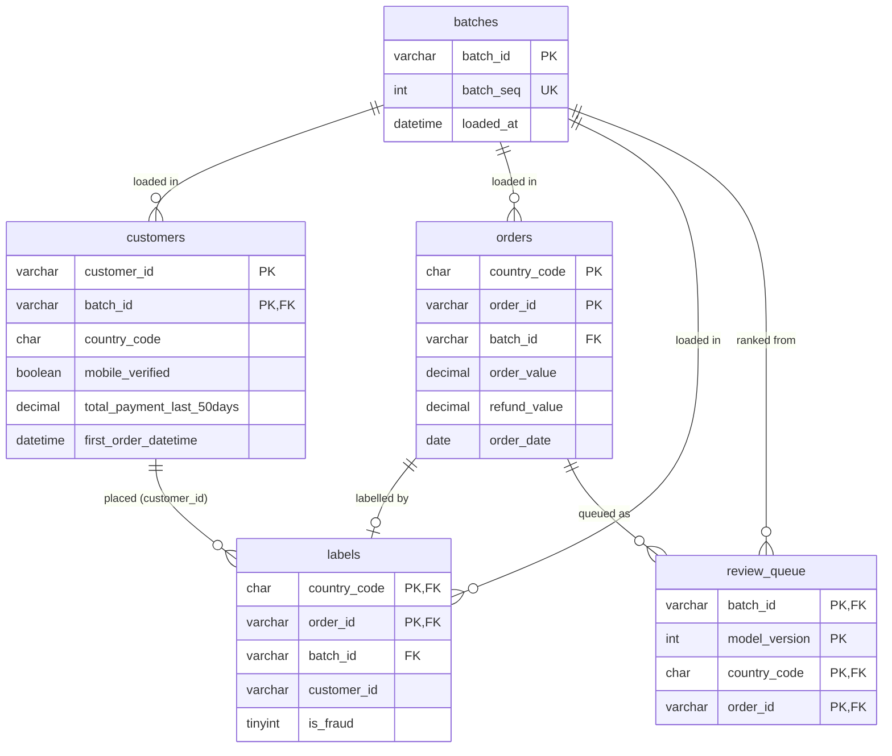

# Data dictionary

The team database in RDS MySQL holds the three source files, one row per source row, plus a table of loaded batches and the daily review queue (issue #33). `src/mlops_fraud_prediction_ca1/schema.sql` creates it, and `docs/runbook.md` gives the steps.

## Diagram

The diagram shows only the key and money columns; the tables below list every column.

## Keys

The keys follow the kickoff data analysis (issue #3), section 4.4 "Linkage findings and handling" in `notebooks/data_analysis.py`:

- **Orders and labels** are keyed by `country_code` and `order_id` together, because three order IDs each appear in two countries.
- **Customers** are keyed by `customer_id` and `batch_id`. Customer IDs are unique across countries, so `country_code` is not part of the key, and a customer can have one row per batch. `docs/time-split.md` still links customers by `country_code` and `customer_id` together. On the base files both find the same customers, because the same section finds that labels and customers agree on every shared customer's country once country codes are normalised.
- **Labels to customers.** A label names its order's customer. This is not a foreign key, because a customer has a row for each batch and two labelled orders in the base files have no customer row.
- **IDs are opaque text** and compare exactly, so `ab12` and `AB12` are different keys, and so are `001` and `1`. The one exception is MySQL's: trailing spaces are ignored, so `o1` and `o1 ` are the same key.

A row whose key is blank or whose country is not recognised cannot be stored, so the loader rejects and counts it.

## Cleaned and original values

Each source column the cleaning module (issue #12) can change is stored twice: the cleaned value under the source column's name, and the original text exactly as it arrived under the same name with `raw_` in front. The cleaned value is empty (NULL) when cleaning could not read the original. IDs are never changed by cleaning, so they have no `raw_` column.

Money uses an exact decimal type with 12 decimal places. Some source amounts have 13 to 16 digits after the point, such as `5.387818896776103`, but the digits past the 12th are far below a cent, so rounding to 12 places changes no amount anyone uses. The `raw_` column keeps the exact text. Counts that the source writes with a decimal point use `DOUBLE`.

## Changes made before loading

`uv run load-batch` cleans each file with the cleaning module (`docs/cleaning.md`, issue #12) before it stores anything. These fixed rules learn nothing from the data, so every batch gets the same treatment:

| Column | Cleaned value |
| --- | --- |
| `country_code` | Upper case without surrounding spaces, if it is one of the five countries; otherwise empty. |
| `collect_type`, `payment_method` | Lower case without surrounding spaces, if it is in the fixed list in `docs/cleaning.md`; otherwise empty. |
| `mobile_verified` | True or false; anything else, such as `yes`, is empty. |
| `order_date` | A date, read from `YYYY/MM/DD`, `YYYY-MM-DD` or `YYYY/Mon/DD`; otherwise empty. |
| `first_order_datetime` | A date and time, read from `YYYY-MM-DD HH:MM:SS`; otherwise empty. |
| counts and money | A number; text, infinity and numbers too large to hold exactly are empty. |
| `is_fraud` | 0 or 1; anything else is empty. |

Values learned from data, such as a column's average for filling gaps, are not applied here. They belong to the model's feature steps (issue #16), fitted on training rows only.

## Loading rules

`uv run load-batch` loads customers, orders and labels in one transaction, so if any part fails, none of the three tables changes. A stored row is never changed: a row whose key is already stored is skipped, so loading the same batch twice changes nothing.

A row that cannot be stored is rejected and counted, and the rest of the batch still loads:

- a blank ID, or an order or label whose country is unknown;
- an ID over 64 characters, or any value over 255 characters, which the columns cannot hold;
- a copy of an earlier row in the same file, where every cleaned value matches;
- rows in the same file that share a key but differ, such as one order with two different labels: none of them is kept, because nothing says which is right;
- a label whose order is in neither this batch nor the database;
- a label whose customer is in neither this batch nor the database;
- a label for an order that already has a different stored label. The stored label stays, so a model's training data never changes under it.

Only the label is compared. An order, or a label with the same `is_fraud`, that comes again in a later batch counts as already stored, even if its other values differ.

A label whose `is_fraud` is not 0 or 1 is stored with an empty `is_fraud`, and reads return it that way, so training code must drop or handle those rows.

The command prints how many rows it added, how many were already stored, and how many it rejected for each reason. It never prints the rows.

A customer gets a new row in each batch that includes them. `rds_reads.read_labelled_orders` gives each order the customer's row from the order's batch, or the latest batch before it, so a later customer row never supplies values to an earlier order. "Latest" means loaded latest, so batches must be loaded in the order they arrived. It applies the holdout setting (issue #6) to every read.

## Tables

### batches

One row per loaded batch.

| Column | Type | Meaning |
| --- | --- | --- |
| `batch_id` | text, key | The suffix the batch's three file names share, such as `base` for `customers_base.csv`. |
| `batch_seq` | whole number | Loading order: 1 for the first batch loaded, then 2, and so on. |
| `loaded_at` | date and time | When the batch row was added, in the server's time zone. |

### customers

One row per customer per batch.

| Column | Type | Meaning |
| --- | --- | --- |
| `customer_id` | text, key | The customer. |
| `batch_id` | text, key | The batch the row came in. |
| `country_code` | 2 letters | The customer's country: `MY`, `PH`, `PK`, `TH` or `BD`. |
| `mobile_verified` | true or false | Whether the customer's mobile number is verified. |
| `num_orders_last_50days` | number | Orders in the last 50 days. |
| `num_cancelled_orders_last_50days` | number | Cancelled orders in the last 50 days. |
| `num_refund_orders_last_50days` | number | Orders with a refund request in the last 50 days. |
| `total_payment_last_50days` | money | Total paid in the last 50 days. |
| `num_associated_customers` | number | Customers linked to this one. |
| `first_order_datetime` | date and time | The customer's first order. |
| `raw_...` | text | The original value of each column above except `customer_id` and `batch_id`. |

Issue #4 records when each customer value becomes known. None is confirmed yet, so none of them is a model input by default.

### orders

One row per order.

| Column | Type | Meaning |
| --- | --- | --- |
| `country_code` | 2 letters, key | The order's country. |
| `order_id` | text, key | The order, unique within its country. |
| `batch_id` | text | The batch the order came in. |
| `collect_type` | text | How the order is collected: `delivery`, `pickup` or `self-pick-up`. |
| `payment_method` | text | How the order was paid, in lowercase, such as `credit card`. |
| `order_value` | money | The order's value when it was placed. |
| `num_items_ordered` | number | Items in the order. |
| `refund_value` | money | The amount refunded. It is known only after the order, so it is used to evaluate models and never as a model input. |
| `order_date` | date | The day the order was placed. |
| `raw_...` | text | The original value of each column above except `order_id` and `batch_id`. |

### labels

One row per labelled order. Every label's order must already be in `orders`.

| Column | Type | Meaning |
| --- | --- | --- |
| `country_code` | 2 letters, key | The order's country. |
| `order_id` | text, key | The order. |
| `batch_id` | text | The batch the label came in. |
| `customer_id` | text | The customer who placed the order. |
| `is_fraud` | 0 or 1 | 1 if the order was fraud. Empty when the source value is not 0 or 1. |
| `raw_country_code`, `raw_is_fraud` | text | The original values. |

### review_queue

One row per order in a batch's daily review queue: each day's riskiest orders, as one version of the champion model ranked them. `uv run review-queue` adds the rows, once per batch and model version (`docs/runbook.md`, "Daily review queue").

| Column | Type | Meaning |
| --- | --- | --- |
| `batch_id` | text, key | The batch whose orders were ranked. |
| `model_version` | number, key | The version of the registered model `fraud-candidate` that scored the orders: the one its alias `champion` named then. |
| `country_code` | 2 letters, key | The order's country. |
| `order_id` | text, key | The order. Its row in `orders` holds the rest of the order. |
| `order_date` | date | The day the order was placed. Each day's orders are ranked separately. |
| `score` | number | The model's fraud score, from 0 to 1. Higher means riskier. |

## Who can read and add rows

The admin user creates the tables and users. Each engineer has their own user, named `<name>_reader`, that can only read. `uv run rds-schema reader <name>` creates it, and the password is never in git. The engineer who loads batches also has `<name>_writer`, made by `uv run rds-schema writer <name>`, which can read and add rows but never change or delete them.
