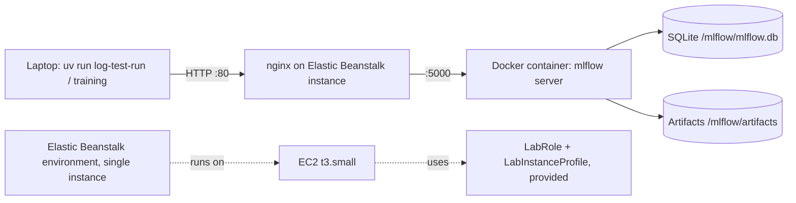

# MLflow deploy runbook

Covers [PBI #26](https://github.com/Glowing6635/MLOps-Fraud-Prediction-CA1/issues/26): deploy the team's MLflow server to Elastic Beanstalk with one script. It documents the basic design in `mlflow-server/` (SQLite and a container folder). The move to RDS and S3 (#9, PR #147) changes the configuration values below; update the tables when #9 merges.

> **Owner-only.** The "More Robust MLflow System Architecture" work (CA1 Requirement 4, and the #8 web GenAI conversation) is done by the owner alone. This runbook records ordinary deployment steps only and proposes no architecture.

## Architecture



Services used: Elastic Beanstalk (Docker platform, single-instance environment), the EC2 instance it launches, the instance's nginx proxy. No load balancer, no IAM resource created. After #9: RDS (backend store and login database) and S3 (artifacts) are added.

## Prerequisites

- EB CLI: `uv tool install --python 3.12 awsebcli`
- AWS CLI, and sandbox credentials from the Learner Lab "AWS Details" panel in `~/.aws/credentials` (they expire when the session ends; paste fresh ones each session). Never commit them.
- A CNAME prefix not yet taken, e.g. `sp-buy-mlflow`.

## Quickstart

From a clean checkout:

```
cd mlflow-server
./deploy.sh <prefix>
```

The script runs `eb init` (first time), then `eb create` (or `eb deploy` if the environment exists), prints `eb status`, and calls `/health`. Success is `Health: Green` and `curl http://<prefix>.<region>.elasticbeanstalk.com/health` returning OK.

Then, from each laptop, set in `.env`:

```
MLFLOW_TRACKING_URI=http://<prefix>.<region>.elasticbeanstalk.com
MLFLOW_EXPERIMENT_NAME=<experiment>
```

and run `uv run log-test-run`. Open the printed run address to see the run.

## Every value

| Name | Value | Why |
| --- | --- | --- |
| Platform | `docker` | Beanstalk builds `mlflow-server/Dockerfile` |
| Region | `AWS_DEFAULT_REGION`, default `us-east-1` | Must match the sandbox's region; the CNAME includes it |
| Environment name | `mlflow` (`EB_ENV_NAME`) | |
| Environment type | single instance (`--single`) | No load balancer |
| Instance type | `t3.small` (2 GB) | The server must fit in 2 GB |
| Service role | `LabRole` | Provided by the sandbox |
| Instance profile | `LabInstanceProfile` | Provided by the sandbox |
| `MLFLOW_SERVER_ALLOWED_HOSTS` | `<prefix>.<region>.elasticbeanstalk.com` | MLflow refuses other Host names (except `/health`, `/version`) |
| `MLFLOW_SERVER_CORS_ALLOWED_ORIGINS` | `http://<prefix>.<region>.elasticbeanstalk.com` | Otherwise web UI changes are refused |
| Image settings | `MLFLOW_SERVER_ENABLE_JOB_EXECUTION=false`, `MLFLOW_DISABLE_TELEMETRY=true`, MLflow pinned to the client version | See `Dockerfile` comments |
| Upload limit | `client_max_body_size 200M` in `.platform/nginx/conf.d/upload_size.conf` | Beanstalk's default is 1 MB |
| Port | 5000 in the container, 80 at the proxy | |

## Environment type and cost

Chosen: single instance, t3.small, no load balancer (a load balancer adds a fixed hourly charge and nothing in the plan needs two instances).

Observed on the existing environment `mlflow` (read-only `aws elasticbeanstalk describe-environments`, `describe-configuration-settings`, `ec2 describe-instances`, `ec2 describe-volumes`, `elbv2 describe-load-balancers`, checked 2026-11-24, us-east-1): `EnvironmentType=SingleInstance`, `InstanceType=t3.small`, `ServiceRole=LabRole`, `IamInstanceProfile=LabInstanceProfile`, one instance (`running`), one 8 GB gp3 root volume, no load balancer in the account, URL `sp-buy-mlflow.us-east-1.elasticbeanstalk.com`. This matches the values above.

Cost, **prices still to be sourced**: the AWS pricing API was not readable with the lab credentials, so no dollar figure is stated. Fill the PRICE cells from the AWS EC2 and EBS pricing pages for us-east-1 and cite the page and date.

| Item | Running | Sandbox stopped |
| --- | --- | --- |
| t3.small compute | PRICE per hour | No compute charge while the instance is stopped (AWS EC2 billing rule: to be confirmed against the pricing page when sourcing; instance state while stopped is not yet observed) |
| Root EBS volume, 8 GB gp3 | PRICE per GB-month | Still charged: volumes persist while the instance is stopped |
| Load balancer | none | none |

Read-only commands used: `aws ec2 describe-instances --filters Name=tag:elasticbeanstalk:environment-name,Values=mlflow --query 'Reservations[].Instances[].[InstanceId,InstanceType,State.Name,BlockDeviceMappings[0].Ebs.VolumeId]'` and `aws ec2 describe-volumes --volume-ids <id> --query 'Volumes[].[Size,VolumeType]'`.

## Troubleshooting

- `ExpiredToken`: the lab restarted; paste fresh credentials.
- Health stays red or the UI refuses changes: re-check the two `MLFLOW_SERVER_*` values match the environment URL, using `eb printenv`.
- Runs vanish after a redeploy or after the sandbox stops: expected until #9 (SQLite and artifacts live in the container).
- Local trial before deploying: `docker build -t mlflow-server . && docker run --rm -m 2g -p 5000:5000 mlflow-server`, then `http://localhost:5000/health`.
- Remove the environment: `eb terminate mlflow` (confirm with the owner first).

## Acceptance evidence for #26 (to complete)

| Criterion | State |
| --- | --- |
| One script, clean checkout, no IAM resource | Script `mlflow-server/deploy.sh` written; not run live |
| Environment type and stopped cost recorded | Type and resources recorded from the live environment (read-only); dollar prices and the stopped-instance observation pending |
| Engineer who did not write it deploys from this runbook | Pending: a teammate follows Quickstart and reports |
| Every service/value named, diagram, followed quickstart | Written here; "followed successfully" pending the teammate run |
