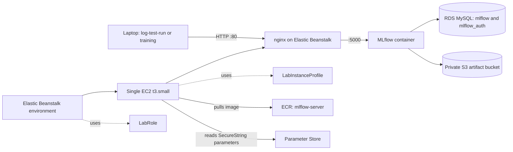

# Deploying the MLflow server

This runbook covers [PBI #26](https://github.com/Glowing6635/MLOps-Fraud-Prediction-CA1/issues/26) using the ECR deployment bundle from [PR #147](https://github.com/Glowing6635/MLOps-Fraud-Prediction-CA1/pull/147).

How to set up the MLflow server's AWS services, build its image and deploy it. `README.md` lists the files and settings.

## Architecture



## Quickstart

For an engineer deploying for the first time. Each step links to the section with the detail. Stop at the first step that fails and use [Troubleshooting](#troubleshooting), unless step 5 explains the failure as an expected first-deploy state.

1. Install Docker, the AWS CLI, curl and EB CLI 3.27.5, and paste the fresh Learner Lab credentials into `~/.aws/credentials`.
2. Set up RDS and S3 ([Set up RDS and S3, once](#set-up-rds-and-s3-once)): the `fraud-mysql84` parameter group, the `mlflow` and `mlflow_auth` databases and `mlflow` user, and a private S3 bucket in `us-east-1`. Skip the port 3306 rule for now: the Beanstalk security group does not exist until step 5 creates the environment.
3. Publish the image and put its tag in `Dockerrun.aws.json` ([Build and push the image](#build-and-push-the-image)).
4. Create the four `SecureString` parameters ([Deploy](#deploy), [Settings](README.md#settings)).
5. Set the two values for this deployment, then run the script from `mlflow-server/`. Quote the variables so Bash does not read `<` or `>` as redirections:

   ```bash
   BUCKET="your-private-bucket"   # the S3 bucket from step 2
   PREFIX="your-cname-prefix"     # a free Beanstalk CNAME prefix
   MLFLOW_ARTIFACTS_DESTINATION="s3://$BUCKET/artifacts" ./deploy.sh "$PREFIX"
   ```

   On a first deployment the script's last command, the `/health` request, is expected to fail (`curl` exits non-zero and the script stops with it), and `eb status` shows a red or degraded environment. The container cannot reach RDS until step 6 adds the ingress rule. That failure is not an error in the deployment itself: go on to step 6 rather than into Troubleshooting.

   The same applies when the script exits during `eb create` before it prints the final `eb status` line: for example a creation wait that times out or reports launch issues. Beanstalk may already have created the environment, so do not treat that as a pre-creation failure. Run `eb list` or `eb status` for the environment name (`mlflow` unless `EB_ENV_NAME` overrides it). If the environment exists, go on to step 6: add the RDS port 3306 ingress rule, then redeploy with `./deploy.sh "$PREFIX"`. Use Troubleshooting only when the script failed before `eb create` ran (credentials, `Dockerrun.aws.json` or a setting) or when no environment exists.
6. On a first deployment, the environment exists (created in step 5, even when that run exited early), so open port 3306 on the RDS security group to the Beanstalk instance's security group (step 3 of [Set up RDS and S3](#set-up-rds-and-s3-once)). Then redeploy with `./deploy.sh "$PREFIX"`, or restart the app server from the Beanstalk console, so the container reconnects. On this run the `/health` request should succeed.
7. Confirm `Health: Green` and that `curl "http://$PREFIX.us-east-1.elasticbeanstalk.com/health"` returns OK.
8. Create each engineer's login and run `uv run log-test-run` ([Check from each laptop](README.md#check-from-each-laptop)).

## Services and configuration values

| Service | What it does here | Value or name to set |
| --- | --- | --- |
| Elastic Beanstalk | Runs the container: application `mlflow-server`, environment `mlflow`, single instance | CNAME prefix `<prefix>`; `EB_ENV_NAME` to rename |
| EC2 and EBS | One `t3.small` instance with an 8 GB gp3 root volume, created by Beanstalk | none |
| nginx (on the instance) | Port 80 to the container's port 5000, 200 MB upload limit | `.platform/nginx/conf.d/upload_size.conf` |
| ECR | Holds the image | repository `mlflow-server`, immutable tags `<MLflow version>-r<n>` |
| RDS MySQL 8.4 | Runs and models (`mlflow`) and logins (`mlflow_auth`) | parameter group `fraud-mysql84`: `log_bin_trust_function_creators=1`, `require_secure_transport=1` |
| S3 | Artifacts, private | `s3://<bucket>/artifacts` |
| Systems Manager Parameter Store | Holds the four secrets | `/mlflow/backend-store-uri`, `/mlflow/auth-database-uri`, `/mlflow/auth-admin-password`, `/mlflow/flask-secret-key` |
| IAM (sandbox, not created) | Provided by the Learner Lab | service role `LabRole`, instance profile `LabInstanceProfile` |

The seven environment variables, with their values, are in [Settings](README.md#settings). Region is `us-east-1` throughout.

## Set up RDS and S3, once

1. MLflow's database setup creates triggers, which RDS refuses while binary logging is on. Attach a parameter group, `fraud-mysql84`, with `log_bin_trust_function_creators` and `require_secure_transport` both set to `1`. The second makes RDS refuse unencrypted connections. Attach the group when you create the instance, as the RDS steps in `docs/runbook.md` (added by #10) do, and no reboot is needed. Reboot the instance only when you attach the group to one that already exists.
2. As the instance's admin user, run `CREATE DATABASE mlflow; CREATE DATABASE mlflow_auth;`, create a `mlflow` user, and grant it `ALL` on both.
3. After the first `./deploy.sh` has created the Beanstalk environment (Quickstart step 5), let the RDS instance's security group accept port 3306 from the Beanstalk instance's security group. That group does not exist before the environment is created, so do this step then, not before.
4. Create an S3 bucket in `us-east-1` with public access blocked. `LabInstanceProfile` gives the server access.

Laptops check the RDS certificate against `src/mlops_fraud_prediction_ca1/rds-global-bundle.pem`, AWS's public certificate bundle for RDS. It was committed to the repository on 18 Nov 2026, from https://truststore.pki.rds.amazonaws.com/global/global-bundle.pem, the same address the `Dockerfile` uses. To check it, compare its SHA-256 with the checksum in the `Dockerfile`'s `ADD` line.

## Build and push the image

You need Docker, and the sandbox credentials in `~/.aws/credentials`, pasted fresh each session. Tags in the `mlflow-server` ECR repository can't be overwritten, so each new image gets the next tag: `<MLflow version>-r<n>`. Then put that tag in `Dockerrun.aws.json`. From this folder:

```bash
ACCOUNT="YOUR_ACCOUNT_ID"   # 12-digit sandbox account ID
TAG="YOUR_TAG"              # next unused tag, for example 3.1.0-r1
REGISTRY="$ACCOUNT.dkr.ecr.us-east-1.amazonaws.com"
aws ecr create-repository --repository-name mlflow-server --image-tag-mutability IMMUTABLE --image-scanning-configuration scanOnPush=true
aws ecr get-login-password --region us-east-1 | docker login --username AWS --password-stdin "$REGISTRY"
docker buildx build --platform linux/amd64 --load -t "$REGISTRY/mlflow-server:$TAG" .
docker push "$REGISTRY/mlflow-server:$TAG"
```

The first command is needed only once. `--platform linux/amd64` matches the t3 instance, even when the laptop has an ARM processor. After changing `requirements.in`, relock with `uv pip compile requirements.in --python-version 3.12 --python-platform x86_64-manylinux_2_28 --generate-hashes --no-header -o requirements.txt`.

## Deploy

Use Bash, AWS CLI, curl and EB CLI 3.27.5
(`uv tool install --python 3.12 awsebcli==3.27.5`).
Refresh the Learner Lab credentials in `~/.aws/credentials` and use the same sandbox
account and region as the published image. The script requires #147's
`Dockerrun.aws.json` and `start.sh` in this checkout.

Create the four `SecureString` parameters named in [Settings](README.md#settings)
in the same account and region before creating an environment. Use
`aws ssm put-parameter --name "/mlflow/YOUR_PARAMETER" --type SecureString --value "YOUR_VALUE"`
with the names and values described there. The script passes only parameter ARNs to the
`aws:elasticbeanstalk:application:environmentsecrets` namespace.

From a clean checkout with the published tag selected in `Dockerrun.aws.json`:

```bash
cd mlflow-server
MLFLOW_ARTIFACTS_DESTINATION=s3://example-artifact-bucket/artifacts ./deploy.sh example-mlflow
```

Replace `example-artifact-bucket` and `example-mlflow` with the private S3 bucket and a free Beanstalk
CNAME prefix. Use the existing environment's prefix for a redeploy.

| Setting | Value |
| --- | --- |
| Application and environment | `mlflow-server` and `mlflow` (override environment with `EB_ENV_NAME`) |
| Region | `us-east-1` (override with `AWS_DEFAULT_REGION` to match the resources and image) |
| Platform and capacity | Docker, single instance, `t3.small` (2 GB) |
| Service role and instance profile | Existing sandbox `LabRole` and `LabInstanceProfile` |
| Container and proxy ports | 5000 and 80 |
| Upload limit | 200 MB, set in `.platform/nginx/conf.d/upload_size.conf` |

On creation, the script supplies all seven [MLflow settings](README.md#settings)
through an EB saved configuration. It gives `eb create --cfg` the logical
template name and removes the local saved configuration on exit. Beanstalk
pulls the image from ECR and resolves the four parameter references for the
container.

To redeploy, run `./deploy.sh "YOUR_EXISTING_CNAME_PREFIX"`. Before running
`eb deploy`, the script checks the CNAME and uses the AWS CLI to verify the
seven settings in the deployed Beanstalk configuration. Both creation and
redeploy require an artifact destination of `s3://<bucket>/artifacts` or
`s3://<bucket>/<prefix>/artifacts`. The script checks the bucket name against
the [S3 general purpose naming rules](https://docs.aws.amazon.com/AmazonS3/latest/userguide/bucketnamingrules.html)
locally on both paths. The optional key prefix can have multiple levels. Use
the literal S3 key prefix without control characters, line breaks, or raw
`?` or `#`. MLflow interprets those delimiters as the start of a URI query or
fragment and would write under a different key. On redeploy, the artifact
destination must appear exactly once in the deployed application environment
namespace. The allowed host and origin must match the CNAME, and the secret
settings must refer to the four documented Parameter Store paths in the current
account and region. If the read fails or a setting is missing or invalid, the
script stops and prints only setting names for configuration mismatches. It
preserves existing properties on redeploy. Set `MLFLOW_ARTIFACTS_DESTINATION`
on the command line for creation.

Check that the printed `eb status` reports `Health: Green` and that the final
`/health` request returns OK. Follow [Check from each laptop](README.md#check-from-each-laptop)
to verify authenticated logging and persistence. The local URI check does not
test whether the bucket exists or whether the service can write to it.

### Troubleshooting

- `ExpiredToken`: refresh the Learner Lab credentials.
- CNAME mismatch: check the selected environment, region and prefix before rerunning.
- Missing or invalid settings: check the environment's deployed configuration
  against [Settings](README.md#settings) and correct it before retrying.
- Could not verify settings: check the selected environment, the sandbox
  session and permission to run `elasticbeanstalk:DescribeConfigurationSettings`.
- Health stays red: check the image tag, instance access to ECR and the four
  parameters, and RDS connectivity. If the web UI refuses changes, check that
  the allowed host and browser origin match the environment URL.

## Environment type and cost

Chosen: single instance, t3.small, no load balancer (a load balancer adds a fixed hourly charge and nothing in the plan needs two instances).

Observed on the existing environment `mlflow` (read-only `aws elasticbeanstalk describe-environments`, `describe-configuration-settings`, `ec2 describe-instances`, `ec2 describe-volumes`, `elbv2 describe-load-balancers`, checked 2026-11-24, us-east-1): `EnvironmentType=SingleInstance`, `InstanceType=t3.small`, `ServiceRole=LabRole`, `IamInstanceProfile=LabInstanceProfile`, one instance (`running`), one 8 GB gp3 root volume, no load balancer in the account, URL `sp-buy-mlflow.us-east-1.elasticbeanstalk.com`. This matches the values above.

Further read-only observations (2026-11-24): `GET /health` returned 200 without a login; `GET /version` returned 401 "You are not authenticated", so the running server already requires a login. The environment properties set are `MLFLOW_ARTIFACTS_DESTINATION`, `MLFLOW_SERVER_ALLOWED_HOSTS` and `MLFLOW_SERVER_CORS_ALLOWED_ORIGINS` (names only; values not read).

The table uses AWS on-demand list prices for US East (N. Virginia). The
stopped column assumes the EC2 instance is stopped and the root volume remains
provisioned at baseline gp3 performance. RDS, S3, ECR and any retained public
IPv4 address can have separate charges. The Learner Lab uses a credit budget.

| Item | Running | EC2 instance stopped |
| --- | --- | --- |
| t3.small compute | USD 0.0208 per hour | USD 0 per hour |
| Root EBS volume, 8 GiB gp3 | USD 0.08 per GiB-month × 8 = USD 0.64 per month | USD 0.64 per month while retained |
| Load balancer | None | None |

Sources: [AWS regional t3.small pricing](https://aws.amazon.com/disaster-recovery/pricing/),
[AWS regional gp3 pricing](https://docs.aws.amazon.com/emr/latest/ManagementGuide/emr-plan-storage-compare-volume-types.html),
[AWS EBS pricing](https://aws.amazon.com/ebs/pricing/), and
[AWS stopped-instance billing](https://docs.aws.amazon.com/AWSEC2/latest/UserGuide/ec2-instance-lifecycle.html#lifecycle-stopped).

Read-only commands used: `aws ec2 describe-instances --filters Name=tag:elasticbeanstalk:environment-name,Values=mlflow --query 'Reservations[].Instances[].[InstanceId,InstanceType,State.Name,BlockDeviceMappings[0].Ebs.VolumeId]'` and `aws ec2 describe-volumes --volume-ids <id> --query 'Volumes[].[Size,VolumeType]'`.

## Evidence status for #26

Written and checked offline: the script (`bash -n`), the architecture diagram, the services table, the quickstart, the environment type and the stopped-instance cost table (read-only AWS observations of 2026-11-24).

Still needs a person with the sandbox, none of which this document can supply:

- AC1: one clean-checkout run of `./deploy.sh` that creates a new environment, with `aws iam list-*` or CloudTrail showing no IAM resource created. Needs the owner's Learner Lab session. Request `agile-mlops-20261124-10`.
- AC2: confirm in the AWS billing view what a stopped sandbox costs. The table above uses list prices, not a bill.
- AC3: a teammate who did not write the script deploys using only this file, and records where they needed help.
- AC4: the same teammate runs the [Quickstart](#quickstart) and reports success; record their name, date and the commit they used.
