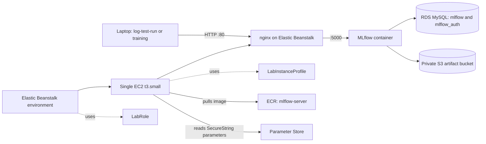

# Deploying the MLflow server

This runbook covers [PBI #26](https://github.com/Glowing6635/MLOps-Fraud-Prediction-CA1/issues/26) using the ECR deployment bundle from [PR #147](https://github.com/Glowing6635/MLOps-Fraud-Prediction-CA1/pull/147).

How to set up the MLflow server's AWS services, build its image and deploy it. `README.md` lists the files and settings.

## Architecture



## Set up RDS and S3, once

1. MLflow's database setup creates triggers, which RDS refuses while binary logging is on. Attach a parameter group, `fraud-mysql84`, with `log_bin_trust_function_creators` and `require_secure_transport` both set to `1`. The second makes RDS refuse unencrypted connections. Attach the group when you create the instance, as the RDS steps in `docs/runbook.md` (added by #10) do, and no reboot is needed. Reboot the instance only when you attach the group to one that already exists.
2. As the instance's admin user, run `CREATE DATABASE mlflow; CREATE DATABASE mlflow_auth;`, create a `mlflow` user, and grant it `ALL` on both.
3. Let the instance's security group accept port 3306 from the Beanstalk instance's security group.
4. Create an S3 bucket in `us-east-1` with public access blocked. `LabInstanceProfile` gives the server access.

Laptops check the RDS certificate against `src/mlops_fraud_prediction_ca1/rds-global-bundle.pem`, AWS's public certificate bundle for RDS. It was committed to the repository on 18 Nov 2026, from https://truststore.pki.rds.amazonaws.com/global/global-bundle.pem, the same address the `Dockerfile` uses. To check it, compare its SHA-256 with the checksum in the `Dockerfile`'s `ADD` line.

## Build and push the image

You need Docker, and the sandbox credentials in `~/.aws/credentials`, pasted fresh each session. Tags in the `mlflow-server` ECR repository can't be overwritten, so each new image gets the next tag: `<MLflow version>-r<n>`. Then put that tag in `Dockerrun.aws.json`. From this folder:

```
aws ecr create-repository --repository-name mlflow-server --image-tag-mutability IMMUTABLE --image-scanning-configuration scanOnPush=true
aws ecr get-login-password --region us-east-1 | docker login --username AWS --password-stdin <account>.dkr.ecr.us-east-1.amazonaws.com
docker buildx build --platform linux/amd64 --load -t <account>.dkr.ecr.us-east-1.amazonaws.com/mlflow-server:<tag> .
docker push <account>.dkr.ecr.us-east-1.amazonaws.com/mlflow-server:<tag>
```

The first command is needed only once. `--platform linux/amd64` matches the t3 instance, even when the laptop has an ARM processor. After changing `requirements.in`, relock with `uv pip compile requirements.in --python-version 3.12 --python-platform x86_64-manylinux_2_28 --generate-hashes --no-header -o requirements.txt`.

## Deploy

Use Bash, AWS CLI, curl and the EB CLI (`uv tool install --python 3.12 awsebcli`).
Refresh the Learner Lab credentials in `~/.aws/credentials` and use the same sandbox
account and region as the published image. The script requires #147's
`Dockerrun.aws.json` and `start.sh` in this checkout.

Create the four `SecureString` parameters named in [Settings](README.md#settings)
in the same account and region before creating an environment. Use
`aws ssm put-parameter --name <parameter> --type SecureString --value <value>`
with the values described there. The script passes only parameter ARNs to the
`aws:elasticbeanstalk:application:environmentsecrets` namespace.

From a clean checkout with the published tag selected in `Dockerrun.aws.json`:

```bash
cd mlflow-server
MLFLOW_ARTIFACTS_DESTINATION=s3://example-artifact-bucket/artifacts ./deploy.sh example-mlflow
```

Replace `example-artifact-bucket` and `example-mlflow` with the private S3 bucket and a free Beanstalk
CNAME prefix. Use the existing environment's prefix for a redeploy.

| Setting | Value |
| --- | --- |
| Application and environment | `mlflow-server` and `mlflow` (override environment with `EB_ENV_NAME`) |
| Region | `us-east-1` (override with `AWS_DEFAULT_REGION` to match the resources and image) |
| Platform and capacity | Docker, single instance, `t3.small` (2 GB) |
| Service role and instance profile | Existing sandbox `LabRole` and `LabInstanceProfile` |
| Container and proxy ports | 5000 and 80 |
| Upload limit | 200 MB, set in `.platform/nginx/conf.d/upload_size.conf` |

On creation, the script supplies all seven [MLflow settings](README.md#settings)
at launch. Beanstalk pulls the image from ECR and resolves the four parameter
references for the container. On redeploy, the script checks the CNAME before
running `eb deploy` and preserves the environment's existing properties. The
artifact destination input is only required for creation.

Check that the printed `eb status` reports `Health: Green` and that the final
`/health` request returns OK. Follow [Check from each laptop](README.md#check-from-each-laptop)
to verify authenticated logging and persistence.

### Troubleshooting

- `ExpiredToken`: refresh the Learner Lab credentials.
- CNAME mismatch: check the selected environment, region and prefix before rerunning.
- Health stays red: check the image tag, instance access to ECR and the four
  parameters, and RDS connectivity. If the web UI refuses changes, check that
  the allowed host and browser origin match the environment URL.

## Environment type and cost

Chosen: single instance, t3.small, no load balancer (a load balancer adds a fixed hourly charge and nothing in the plan needs two instances).

Observed on the existing environment `mlflow` (read-only `aws elasticbeanstalk describe-environments`, `describe-configuration-settings`, `ec2 describe-instances`, `ec2 describe-volumes`, `elbv2 describe-load-balancers`, checked 2026-11-24, us-east-1): `EnvironmentType=SingleInstance`, `InstanceType=t3.small`, `ServiceRole=LabRole`, `IamInstanceProfile=LabInstanceProfile`, one instance (`running`), one 8 GB gp3 root volume, no load balancer in the account, URL `sp-buy-mlflow.us-east-1.elasticbeanstalk.com`. This matches the values above.

Further read-only observations (2026-11-24): `GET /health` returned 200 without a login; `GET /version` returned 401 "You are not authenticated", so the running server already requires a login. The environment properties set are `MLFLOW_ARTIFACTS_DESTINATION`, `MLFLOW_SERVER_ALLOWED_HOSTS` and `MLFLOW_SERVER_CORS_ALLOWED_ORIGINS` (names only; values not read).

Cost: the t3.small Linux on-demand price in US East (N. Virginia) is **USD 0.0208 per hour**, read on 2026-11-24 from AWS's public price list file `https://b0.p.awsstatic.com/pricing/2.0/meteredUnitMaps/ec2/USD/current/ec2-ondemand-without-sec-sel/US%20East%20(N.%20Virginia)/Linux/index.json` (about USD 15 per 30-day month if left running; this is arithmetic on that price, and the Learner Lab bills against its credit budget, not this list price). The gp3 volume price could not be read from a public file and is **pending**: take it from the AWS EBS pricing page.

| Item | Running | Sandbox stopped |
| --- | --- | --- |
| t3.small compute | USD 0.0208 per hour | No compute charge while the instance is stopped (AWS EC2 billing rule: to be confirmed against the pricing page when sourcing; instance state while stopped is not yet observed) |
| Root EBS volume, 8 GB gp3 | PENDING (GB-month price) | Still charged: volumes persist while the instance is stopped |
| Load balancer | none | none |

Read-only commands used: `aws ec2 describe-instances --filters Name=tag:elasticbeanstalk:environment-name,Values=mlflow --query 'Reservations[].Instances[].[InstanceId,InstanceType,State.Name,BlockDeviceMappings[0].Ebs.VolumeId]'` and `aws ec2 describe-volumes --volume-ids <id> --query 'Volumes[].[Size,VolumeType]'`.

## Acceptance evidence for #26 (to complete)

| Criterion | State |
| --- | --- |
| One script, clean checkout, no IAM resource | Script `mlflow-server/deploy.sh` written; not run live |
| Environment type and stopped cost recorded | Type and resources recorded from the live environment (read-only); t3.small price recorded, gp3 price and stopped-instance observation pending |
| Engineer who did not write it deploys from this runbook | Pending: a teammate follows Quickstart and reports |
| Every service/value named, diagram, followed quickstart | Written here; "followed successfully" pending the teammate run |
